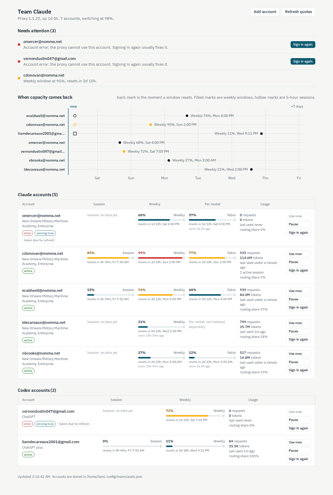

# Team Claude dashboard

A web dashboard for the [Team Claude](https://github.com/KarpelesLab/teamclaude)
multi-account proxy. It shows, for every pooled Claude and Codex account:

- which accounts need a human (errors, rejected credentials, expired sign-ins, near-limit windows), listed first with a one-click fix;
- a timeline of when each quota window resets, so you can see the order capacity comes back;
- per-window meters (5-hour session, weekly, per-model) with reset countdowns and staleness;
- request and token usage, active sessions, and the proxy's routing share;
- sign-in for Claude and Codex accounts from the browser, no terminal needed;
- users: give each person their own proxy key and see their requests and tokens (all time, last 24 h, last 5 h);
- a request log: what finished in each polling interval, by user and by account, with no prompt contents stored;
- light, dark, or system theme.



The dashboard is read-mostly: all quota data comes from the proxy's own
`/teamclaude/status` endpoint, and account changes are written with Team
Claude's own config code (same matching, same atomic write) and then the proxy
is told to reload.

## Run with Docker

The proxy listens on `127.0.0.1:3456` by default, so the container shares the
host network. The config file's directory is mounted so sign-ins can be saved.

```sh
cp .env.example .env     # set DASHBOARD_PASSWORD if the port is reachable by others
docker compose up -d --build
```

Open <http://localhost:8787>. If 8787 is taken, set `PORT` in `.env`.
User and sign-in changes are written to the mounted config; the request log
goes to the data directory, which the compose file also mounts.

| Variable | Default | Meaning |
|---|---|---|
| `PORT` | `8787` | Port the dashboard listens on |
| `DASHBOARD_PASSWORD` | empty | HTTP Basic auth password (any username). Strongly recommended. |
| `TEAMCLAUDE_URL` | `http://127.0.0.1:3456` | Where the proxy listens |
| `TEAMCLAUDE_CONFIG_DIR` | `~/.config` | Directory containing `teamclaude.json` |
| `TEAMCLAUDE_API_KEY` | from config | Override the proxy key if the config is not mounted |
| `DASHBOARD_DATA_DIR` | `./data` | Where the request log (`activity.jsonl`) is kept |
| `POLL_MS` | `5000` | How often the proxy is polled for the request log |

If the proxy runs on another machine, point `TEAMCLAUDE_URL` at it and mount a
copy of its config, or set `TEAMCLAUDE_API_KEY`. Sign-in needs write access to
the config the proxy reads, so remote setups can view but not add accounts.

## Reach it over Tailscale

The dashboard binds every interface on the host, so with Tailscale on the
machine it is reachable from any device on your tailnet at
`http://<tailscale-ip>:<PORT>` or `http://<machine-name>:<PORT>` with MagicDNS.
The browser asks for the password once (any username). Keep
`DASHBOARD_PASSWORD` set whenever the port is reachable beyond localhost.

## Run without Docker

```sh
npm install
PORT=8787 node server.js
```

## Signing an account in from the browser

**Claude**: Add account → Claude, or "Sign in again" on a row. Open the link,
approve access, copy the code Anthropic shows, paste it, finish. The account is
matched on its account and organization identity, so re-signing an existing
account refreshes it in place.

**Codex**: OpenAI only redirects to `http://localhost:1455/auth/callback`. After
you approve, the browser lands on that address, which usually fails to load.
Copy the full address from the address bar and paste it in the dialog; the
dashboard reads the code from it.

Both flows use PKCE with a state value checked on return. Tokens never reach the
browser.

## Users and the request log

Team Claude attributes usage to whoever presents a `proxy.clientKeys` entry
instead of the shared key. The Users section manages those entries: add a
user to mint a key (shown once), rotate it, or remove it. The proxy reloads
immediately. Team Claude books requests and tokens per user; it does not
enforce per-user limits, and the dashboard does not pretend otherwise.

The request log is derived: the dashboard polls the proxy every 5 seconds and
records what the cumulative counters did between polls, per account and per
user. One row is one interval with activity. Rows are kept for 7 days in
`activity.jsonl` under the data directory. Nothing about prompt or response
content is recorded. If you need full request bodies for debugging, Team
Claude's own `logDir` setting writes one file per request; see its
configuration docs.

## Security notes

- Anyone who can reach the dashboard can switch, pause and re-sign accounts, and
  the dashboard holds the proxy's API key. Set `DASHBOARD_PASSWORD` and keep the
  port on a trusted network.
- State-changing requests are refused when a browser sends a foreign `Origin`.
- Static files are served with a strict Content Security Policy; the only
  external resource is the IBM Plex Sans font from Google Fonts, which falls back
  to the system sans when offline.

## Development

```sh
npm test
```

Shared logic (what counts as "needs attention", meter rows, severity) lives in
`lib/attention.js` and is used by both the server tests and the page.
